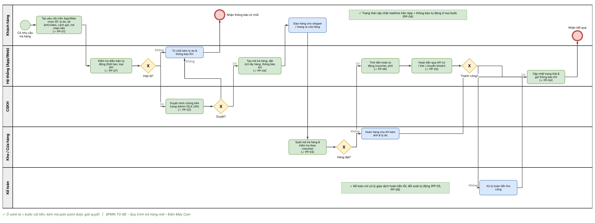
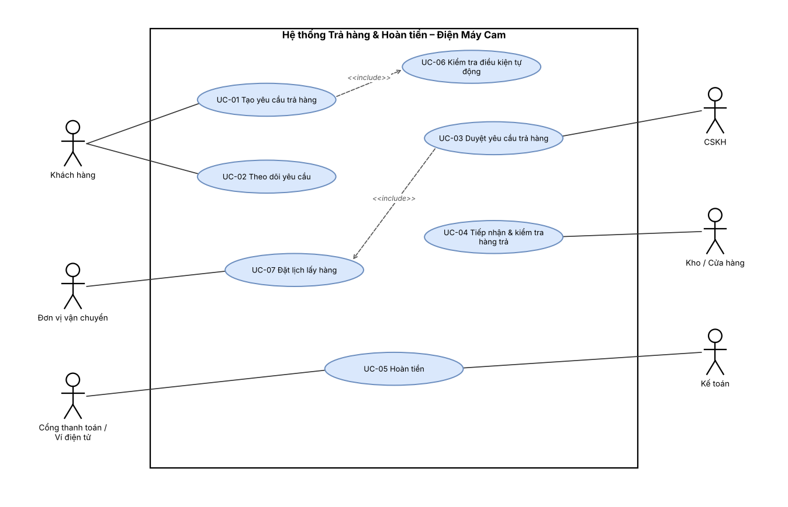
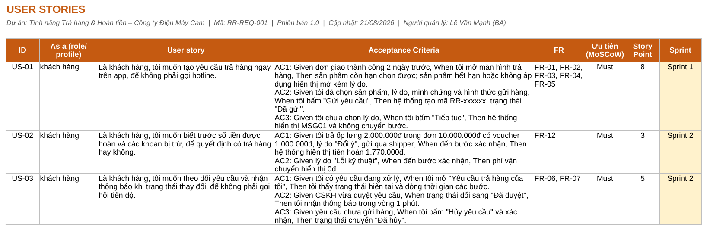
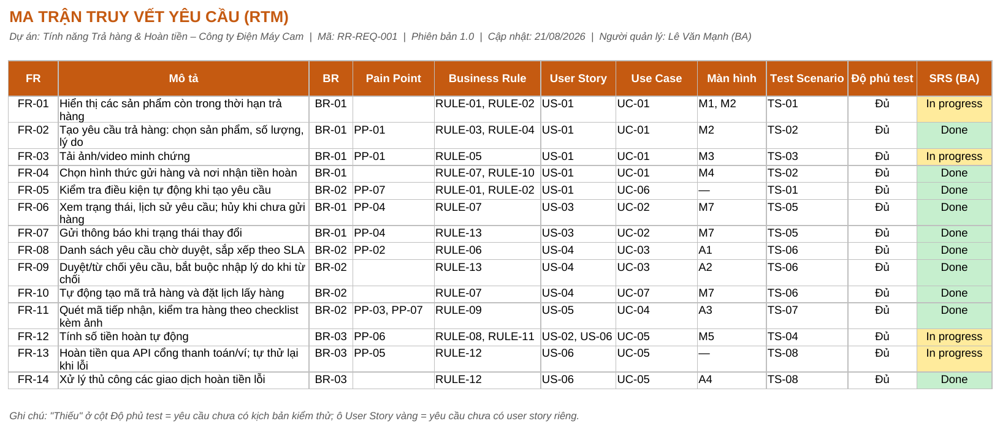
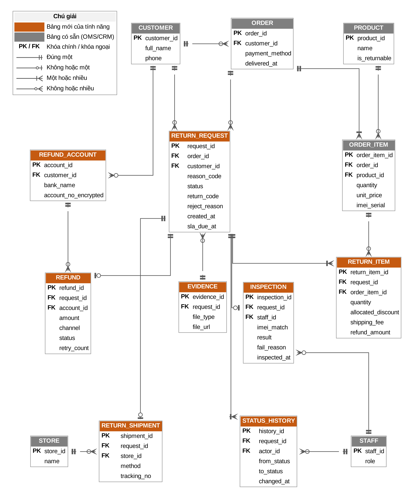
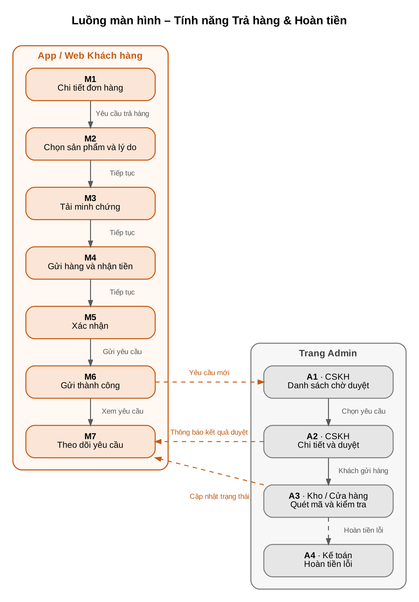
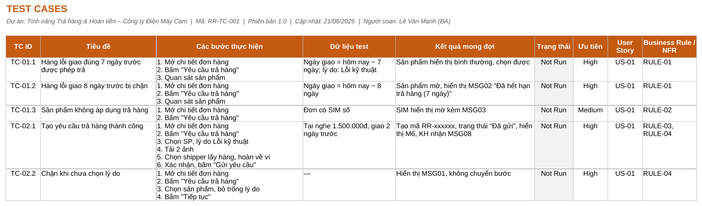
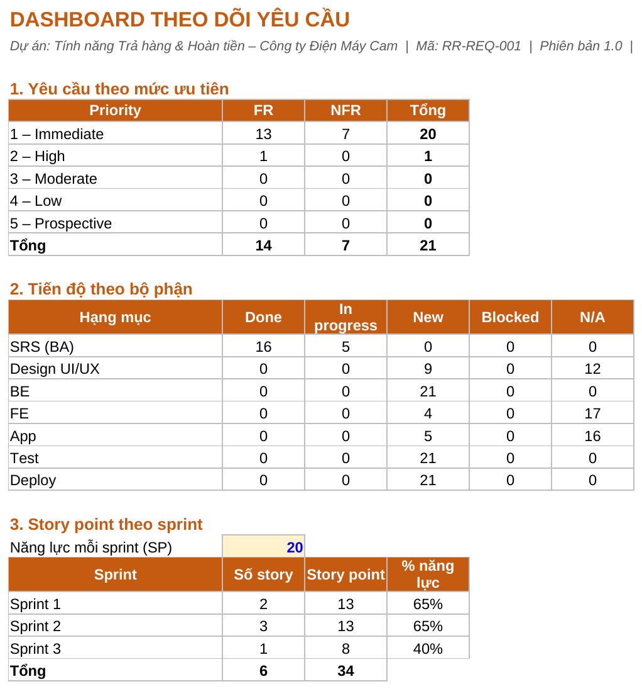
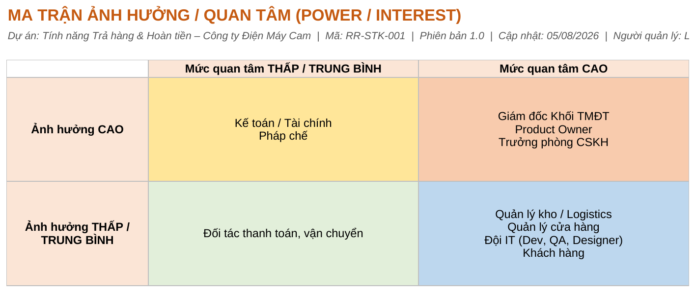

# Return & Refund Feature – Business Analysis Portfolio Project

> Dự án BA giả lập: số hóa quy trình **Trả hàng & Hoàn tiền** cho app bán lẻ của **Công ty Điện Máy Cam** (doanh nghiệp giả lập).
> Mọi số liệu trong dự án là **giả lập**, phục vụ mục đích học tập và portfolio.

## Tóm tắt
- **Vấn đề:** Trả hàng đơn online xử lý thủ công qua hotline, email, Excel; mất 5–7 ngày, hoàn tiền 7–10 ngày; ~25% cuộc gọi hotline liên quan trả hàng.
- **Giải pháp:** Khách tự tạo và theo dõi yêu cầu trả hàng trên App/Web; CSKH, Kho, Kế toán xử lý trên một hệ thống; hoàn tiền tự động qua cổng thanh toán.
- **Phạm vi phiên bản 1:** Trả hàng & Hoàn tiền cho đơn online. Đổi hàng hoãn sang phiên bản 2 (CR01).
- **Mục tiêu chính:** Duyệt yêu cầu ≤ 24h, hoàn tiền ví ≤ 24h, giảm 40% cuộc gọi hotline về trả hàng.

## Số liệu chính
7 use case · 13 business rule · 14 FR · 7 NFR · 6 user story · 29 test case · 8 kịch bản UAT

## Bộ tài liệu (theo vòng đời công việc BA)

| Giai đoạn | Tài liệu | Mã | Định dạng |
|---|---|---|---|
| **I. Khởi động** | [BRD – Business Requirements Document](01-initiation/ReturnRefund_BRD_v1.0.xlsx): problem statement, phạm vi, business drivers, quy trình hiện tại/đề xuất, yêu cầu nghiệp vụ | RR-BRD-001 | Excel |
| | [Stakeholder Register](01-initiation/ReturnRefund_Stakeholder_Register_v1.0.xlsx): stakeholder, ma trận Power/Interest, RACI, Communication Plan | RR-STK-001 | Excel |
| **II. Phân tích yêu cầu** | [MOM – Biên bản họp](02-requirements/ReturnRefund_MOM_v1.0.xlsx): kickoff, 5 buổi phỏng vấn, workshop Business Rules, bộ câu hỏi 5W1H | RR-MOM-001 | Excel |
| | [SRS – Đặc tả yêu cầu phần mềm](02-requirements/ReturnRefund_SRS_v1.0.docx) ([bản PDF](02-requirements/ReturnRefund_SRS_v1.0.pdf)): phân quyền, dữ liệu, 13 Business Rules, đặc tả 3 use case chính, activity flow, mô tả màn hình, NFR, danh sách thông báo | RR-SRS-001 | Word |
| | [Requirements List](02-requirements/ReturnRefund_RequirementsList_v1.0.xlsx): danh sách yêu cầu và tiến độ, User Story Backlog (6 story, 34 SP, 3 sprint), RTM, câu hỏi mở, CR management | RR-REQ-001 | Excel |
| **III. Thiết kế** | ERD, luồng màn hình: [`03-design/diagrams/`](03-design/diagrams/) (mô hình dữ liệu và mô tả màn hình chi tiết trong SRS) | — | PNG |
| | Wireframe màn hình: *đang thực hiện* | — | Figma |
| **IV. Kiểm thử** | [Test Cases & UAT](04-testing/ReturnRefund_TestCases_UAT_v1.0.xlsx): 9 kịch bản, 29 test case, UAT checklist, defect log | RR-TC-001 | Excel |
| | [UAT Plan](04-testing/ReturnRefund_UAT_Plan_v1.0.docx): tiêu chí, lịch UAT, biên bản nghiệm thu | RR-UAT-001 | Word |

Sơ đồ (BPMN, use case, activity flow): [`02-requirements/diagrams/`](02-requirements/diagrams/) · file `.drawio` chỉnh sửa được bằng draw.io.

## Xem nhanh

### 1. Quy trình đề xuất (BPMN TO-BE)
Khách tự tạo yêu cầu trên App; CSKH duyệt, Kho kiểm tra, hệ thống hoàn tiền tự động; Kế toán chỉ xử lý giao dịch lỗi.



### 2. Sơ đồ use case
7 use case cho 6 nhóm người dùng; 3 use case chính (UC-01, UC-03, UC-05) được đặc tả chi tiết trong SRS.



### 3. User Story Backlog
6 user story, tiêu chí chấp nhận viết theo Given/When/Then, gắn FR, độ ưu tiên MoSCoW, story point và sprint.



### 4. Ma trận truy vết yêu cầu (RTM)
Mỗi yêu cầu chức năng được truy vết tới nghiệp vụ, pain point, business rule, user story, use case, màn hình và kịch bản kiểm thử.



### 5. Mô hình dữ liệu (ERD) và luồng màn hình
ERD mức logic (crow's foot): bảng màu cam là dữ liệu mới, bảng màu xám là dữ liệu có sẵn từ OMS/CRM.

<p>


</p>

### 6. Test case
29 test case cho 9 kịch bản, gồm các trường hợp biên khi tính thời hạn và số tiền hoàn.



### 7. Dashboard theo dõi và ma trận stakeholder
Dashboard tự tính bằng công thức Excel; ma trận Power/Interest tự phân nhóm stakeholder.

<p>


</p>

## Cấu trúc thư mục
```
return-refund-ba/
├── 01-initiation/      BRD (.xlsx), Stakeholder Register (.xlsx)
├── 02-requirements/    MOM (.xlsx), SRS (.docx + .pdf), Requirements List (.xlsx), diagrams/
├── 03-design/          diagrams/ (ERD, screen flow)
├── 04-testing/         Test Cases & UAT (.xlsx), UAT Plan (.docx)
└── assets/preview/     Ảnh xem trước cho README
```

## Công cụ
MS Word · MS Excel · draw.io (BPMN, UML) · GitHub
